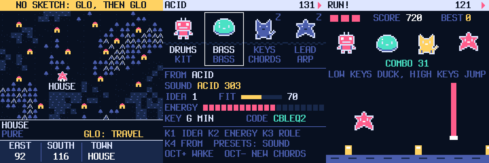

# Pocket Band



A firmware for the M-VAVE FM-1 that writes music with you. Pick a place on a map of genre towns and it
writes a four-piece sketch (drums, bass, keys, lead) in one key and tempo, with sounds to match. Then
re-roll any member, audition replacements, change the key, let the band jam, play punch-in effects on
the keys, edit any part step by step, and keep what you like in four save slots.

**Status: 0.4, experimental.** 0.2 has been installed and run on an FM-1. What 0.3 and 0.4 add is tested
on a computer against the real sound engines and sequencer (see Tests), not yet on the device. Install at
your own risk.

Pocket Band has its own interface and its own music generator. Its sound engines, sequencer, storage,
USB and hardware drivers come from [SLOOP 2.8.5](https://github.com/isod89/sloop-fm1) by isod89, which
is based on [Felucca](https://github.com/hugelton/Felucca) by Leo Kuroshita (Hügelton Instruments).
See [CREDITS.md](CREDITS.md).

**[How to use it](GUIDE.md)** · **[A demo to run through](DEMO.md)** · **[Changes](CHANGELOG.md)**

## How it works

One rule: **a button opens its screen; pressed again, it does that screen's main action.**

| Button | Screen | Knobs 1 to 4 | Button again |
| --- | --- | --- | --- |
| HOME | **Stage**: the band | idea, energy, role, from | wake / sleep the member |
| GLO | **Map**: 16 genre towns | east, south, town | travel: a new sketch |
| EDIT | **Audition**: three other players, ranked by fit | pick, more | hire the one you picked |
| SEQ | **Grid**: the member's part, step by step | step, note, length, bar | put / remove a note |
| ENV | **Sound**: three pages of four knobs | (the page's four) | next page |
| LFO | **Jam**: the band changes its own parts | how often, energy, morph, tour | change a part now |
| FX | **Perform**: the 27 keys are effects | filter, dust, duck, fade | build, then drop |
| SEL | **Key**: key, scale, swing, chords | root, scale, swing, chords | next chord set |
| ARP | **Visuals**: scope, meters, stars, and the run | mode | next mode (the run: start) |
| SAVE | **Cart**: code, slots, setup | page, then that page's | do it |

On every screen:

- **ALGORITHM** picks the band member, **PRESETS** its sound, **SELECT** the tempo.
- The **keys** play the selected member, in the sketch's key. On Perform they are the effects.
- **OCT− / OCT+** move the keys an octave. On Jam they kill / keep the last change; on Perform they
  are the reverb and echo throws; on the drums, held, they play a ghost or a hard hit.
- **PLAY** starts and stops. **REC** records what you play into the member's part. **REC again** is TAP:
  the part is emptied and any key taps its rhythm in, with the notes picked for you from each bar's
  chord (bass: root, fifth, octave by how high the key; keys: the whole chord; lead: a tone that rises
  with the key; drums: kick, snare, hat by thirds of the keyboard). REC a third time ends it.

Notes on a few screens:

- **Map.** In a town you get that genre pure. Between two towns you get a blend: the tempo and swing sit
  between the two and each member comes from one town or the other.
- **Stage.** IDEA and ENERGY write a part again from its seed, so hand edits to that part are replaced.
  Shape the sketch first, edit afterwards.
- **Jam.** MORPH leans every part towards its next idea, step by step: 0 is the part as it is, 100 the
  next idea. The same morph always gives the same notes. TOUR sends the band on along the map by
  itself every 16 or 32 bars: a few steps from where it stands, then a new sketch there.
- **Map.** There is something off the south-east corner.
- **Codes.** Four six-letter words are not places: FASTER, SLEEPY, PARTY2 and SECRET.
- **Perform.** FX again: from the next bar, two bars of a snare roll with the bass out and the filter
  rising, then the drop: the drums back, the filter open, everyone awake.
- **The run.** The fourth of the Visuals is a game. The selected member runs along the drum part that
  is playing: a kick is a block to jump, a snare a beam to duck. The high keys (or OCT+) jump, the low
  keys (or OCT−) duck. A miss puts a member of the band to sleep; twelve clean in a row wake one. Every
  sketch is a level.
- **Cart.** A six-letter code rebuilds a sketch exactly as it was generated. Later edits live in the
  four slots A to D, which can be played from the next bar while the music runs, or chained to play in
  turn. SETUP holds the lights, click, clock source, USB audio rate, the skin (six colour sets),
  calibration, a new empty sketchbook, and ABOUT.
- **Switching off.** The sketch is remembered: its code, each member's idea, the energy, the morph, the
  place on the map, the skin and the best run come back with the music at the next power-on. It is
  written a few seconds after you stop and leave the FM-1 alone.

## Install

1. Download `pocket-band-installer.html` from the [latest release](https://github.com/elpabl0/pocketband/releases/latest)
   and open it in Chrome or Edge on a computer.
2. Connect the FM-1 with a USB-C data cable, straight to the computer.
3. Press INSTALL and leave the FM-1 alone until the page says it is done.

The release also has the bare package, `pocketband.fwsc`, for other installers.

**If the FM-1 does not start afterwards:** switch it off, hold OCT− alone and switch it on (USB rescue),
then install again.

**To leave:** install any other firmware the usual way, for instance SLOOP from its own page, or the
original firmware with M-VAVE's M-UPGRADE. While stopped, holding OCT− and OCT+ together for five
seconds puts the FM-1 in update mode.

### What it does to data already on the FM-1

- Pocket Band **cannot open** projects or samples of the original M-VAVE firmware or of firmwares outside
  the Felucca family.
- It uses the **same flash areas and formats as SLOOP** for the four project slots and
  the settings. Slots saved with SLOOP load as plain notes and sounds, and Pocket Band **overwrites** a
  slot when you store to it. Back up with the other firmware's own tool before installing.
- Its own sketch record sits in the last 8 KB of SLOOP's fourth user-sample slot. A sample there longer
  than 72 KB loses its tail.
- It does not load user samples.

### On USB

The package identity is `FM-1_7226` followed by the version's two digits (0.4: `FM-1_722604`). The
MIDI port is named **Felucca**, and the update loader is Felucca's, unchanged (**Felucca Update**,
`ota-FM-1_900`), so installers that know SLOOP or Felucca find the FM-1 and can resume an interrupted
update. Both flash chips the FM-1 ships with are accepted (P25Q80 and UC25HQ80).

## Build

Linux x86-64 (or Docker), the JieLi toolchain and three SDK files: see [BUILDING.md](BUILDING.md).

```sh
sh build.sh
```

makes `build/pocketband.fwsc` (the package) and `build/pocket-band-installer.html` (the package inside
a page that installs it).

## Tests

`sh tests/run_tests.sh` runs the engine and sequencer tests inherited from SLOOP, plus:

- `tests/pb_brain_test.c`: the generator alone: same seed, same music; notes in range and in the
  scale; more energy never removes a hit; codes round-trip.
- `tests/pb_fw_test.c`: the whole interface over the real sequencer and engines on the host: every
  screen, knob and button, every town rendered to audio, slots, codes, the build and drop, the run
  (lost untouched, won by a player that reads the track), the sketch written to a simulated flash and
  read back, and 12,000 frames of random input, also under AddressSanitizer and UBSan. Screens land in `build/host/pb/`.

## Source map

- `firmware/src/pb_brain.c`: genre profiles and pattern generators (plain C, integers only).
- `firmware/src/pb_band.c`: the map, the members, writing a sketch into the tracks.
- `firmware/src/pb_ui.c`: every screen, the buttons, the LEDs, the boot screen.
- `firmware/src/pb_store.c`: the sketch kept across power-off.
- `firmware/src/pb_core.c`: sound loading, undo, calibration (taken from SLOOP's interface code).
- Everything else under `firmware/` is SLOOP's and Felucca's code. File and macro names there keep
  `felucca` / `FELUCCA_`; comments that say where a piece came from are left as they were.
- `web/`, `tools/`: the installer page, the update protocol in JavaScript and Python, the build.
- `prototype/`: the browser prototype the design started from.

## Licence

GPL-3.0-only, as SLOOP and Felucca; see [LICENSE](LICENSE), [LICENSING.md](LICENSING.md),
[CREDITS.md](CREDITS.md) and `LICENSES/`. "M-VAVE" and "FM-1" are trademarks of their owners; this is independent firmware, not
affiliated with or supported by them, nor by the SLOOP or Felucca authors.

You can also try Pocket Band in the browser, no flashing needed, in the free community [FM-1 Emulator](https://fm1-emulator.atst.tools/).
